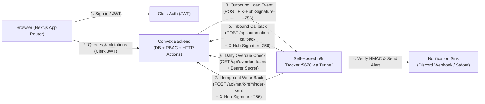

# LendLoop

> **Borrow what you need. Lend what you don't.**

**LendLoop** is a neighborhood tool-lending board built with **Next.js (App Router)**, **Clerk**, **Convex**, and self-hosted **n8n** workflows. It combines privacy-preserving public browsing, strict backend-enforced RBAC, and two-way HMAC-SHA256–authenticated workflow automations — running 100% on free tiers.

---

## Features

- **Privacy-Preserving Public View:** Unauthenticated visitors see **only** currently available tools' **Name** and **Category** — owner identities, descriptions, conditions, and loan history are strictly stripped on the backend.
- **Full Borrowing & Lending Lifecycle:**
  - List tools with `name`, `category` (`Power Tools`, `Garden`, `Kitchen`, `Camping`, `Electronics`, `Other`), `condition` (`Like New`, `Good`, `Fair`), and `description`.
  - Browse all tools with availability status (`Available` / `Borrowed`), category filters, search, and **Trusted Lender** badges.
  - Request borrow windows (`startDate`, `endDate`, optional note) with duplicate-request and self-borrow guards.
  - Tool owners can **Approve** (marks tool `borrowed`, auto-declines competing pending requests), **Decline** (keeps tool `available`), and **Mark as Returned** (marks tool `available` again).
- **Strict Backend RBAC (`admin` & `user`):**
  - Regular users can only edit/delete their own listings and approve/decline/return requests on their own tools.
  - Admins can remove any listing, inspect all loans platform-wide, and toggle the **Trusted Lender** badge on any user.
  - Admin elevation is restricted to a Convex `internalMutation` (CLI / Dashboard only) — no client-callable privilege-escalation endpoint exists.
- **Automated Workflows (Self-Hosted n8n) + Live Loan Activity:**
  - **Workflow 1 (`request-notification.json`):** Webhook-triggered on loan `created`, `approved`, `declined`, and `returned` events with two-way **HMAC-SHA256** verification, data minimization, retries, and live callback updates displayed directly on each loan card (e.g., *"Request notification sent 1 min ago"*).
  - **Workflow 2 (`overdue-reminders.json`):** Daily scheduled (plus manual trigger) overdue-loan scan with double-guarded idempotency (`loanId:YYYY-MM-DD` key + `overdueReminderSentAt` check) so retries never send duplicate reminders.
  - **Error Workflow (`error-handler.json`):** Captures any failed workflow execution so automation errors are logged/alerted and never fail silently.

---

## System Architecture



```text
+-------------------+       Clerk JWT        +-----------------------------------+
|  Next.js Frontend | ---------------------> |          Convex Backend           |
|  (Public + Auth)  | <--------------------- |  - Public listPublic (minimized)  |
+-------------------+    Real-time Queries   |  - RBAC Guards (requireUser/Admin)|
                                             |  - HTTP Actions (HMAC + Bearer)   |
                                             +-----------------+-----------------+
                                                               |  ^
                      Outbound HMAC-SHA256 Webhook             |  |  Inbound HMAC-SHA256 Callbacks
                      (POST /webhook/lendloop-request-event)   |  |  & Bearer GET /api/overdue-loans
                                                               v  |
                                             +-----------------------------------+
                                             |     Self-Hosted n8n (Docker)      |
                                             |  - Workflow 1: Request Notify     |
                                             |  - Workflow 2: Overdue Reminders  |
                                             |  - Error Workflow (Dead-Letter)   |
                                             +-----------------+-----------------+
                                                               |
                                                               v
                                                Discord Webhook / Console Log
```

---

## Tech Stack

| Layer | Technology | Cost |
| --- | --- | --- |
| Frontend | Next.js 15 (App Router), React 19, TypeScript, Tailwind CSS, Lucide Icons | Free (Local) |
| Authentication | Clerk (`@clerk/nextjs`) with Convex JWT Template | Free Tier |
| Database & Backend | Convex (Queries, Mutations, Scheduled Actions, HTTP Router) | Free Tier |
| Workflow Automation | Self-hosted n8n via Docker Compose + Cloudflare Quick Tunnel / ngrok | Free (Local) |

---

## Local Setup Guide

### Prerequisites
- Node.js 20.9+ and npm
- Docker Desktop (for local n8n)
- A free Clerk account (with the **Convex** JWT template enabled under *Configure → JWT Templates → New template → Convex*)
- A free Convex deployment
- `cloudflared` (`brew install cloudflared`) or `ngrok` for a temporary local webhook tunnel

### 1. Clone & Install Dependencies
```bash
git clone <your-repo-url>
cd LendLoop
npm install
```

### 2. Configure Environment Variables

Copy `.env.example` to `.env.local` and fill in your Clerk and Convex values:
```bash
cp .env.example .env.local
```

Generate a 32-byte shared HMAC secret for Convex ↔ n8n communication:
```bash
openssl rand -hex 32
```

Set required Convex deployment environment variables:
```bash
npx convex env set CLERK_JWT_ISSUER_DOMAIN "https://<your-clerk-domain>.clerk.accounts.dev"
npx convex env set N8N_WEBHOOK_SECRET "<your-64-char-hex-secret>"
```

### 3. Run Convex & Next.js
Open two terminals:
```bash
# Terminal 1: Convex dev server (syncs schema, functions & HTTP routes)
npx convex dev

# Terminal 2: Next.js dev server
npm run dev
```
Open http://localhost:3000.

### 4. Promote Your Test User to Admin (Optional)
Sign in once at http://localhost:3000 so your user record syncs to Convex, then run:
```bash
npx convex run users:promoteToAdmin '{"email":"you@example.com"}'
```
Refresh the app — the **Admin** badge and **Admin Panel** tab will appear immediately.

### 5. Start Local n8n + Tunnel
Start a free tunnel to port `5678` (keep this terminal running):
```bash
cloudflared tunnel --url http://localhost:5678
```
Copy the `https://<random>.trycloudflare.com` URL it prints, then set it in Convex and in a gitignored `.env` file for Docker Compose:

```bash
npx convex env set N8N_REQUEST_WEBHOOK_URL "https://<random>.trycloudflare.com/webhook/lendloop-request-event"

cat << 'EOF' > .env
N8N_WEBHOOK_SECRET=<your-64-char-hex-secret>
N8N_TUNNEL_URL=https://<random>.trycloudflare.com/
CONVEX_SITE_URL=https://<your-deployment>.convex.site
DISCORD_WEBHOOK_URL=
EOF

docker compose up -d
```

### 6. Import & Activate the n8n Workflows
1. Open http://localhost:5678 and complete the initial local owner setup.
2. Import all three JSON files from [`n8n-workflows/`](n8n-workflows/) via **Create Workflow → `⋮` → Import from File**:
   - [`n8n-workflows/error-handler.json`](n8n-workflows/error-handler.json) *(save first)*
   - [`n8n-workflows/request-notification.json`](n8n-workflows/request-notification.json)
   - [`n8n-workflows/overdue-reminders.json`](n8n-workflows/overdue-reminders.json)
3. In both **Workflow 1** and **Workflow 2**, open **`⋮` → Settings → Error Workflow** and select **`LendLoop - Error Workflow (Dead-Letter Alerting)`**.
4. Toggle **Active** ON for **Workflow 1** and **Workflow 2**.

---

## Environment Variables Reference

| Variable | Location | Required | Purpose |
| --- | --- | --- | --- |
| `NEXT_PUBLIC_CLERK_PUBLISHABLE_KEY` | `.env.local` | Yes | Clerk frontend publishable key |
| `CLERK_SECRET_KEY` | `.env.local` | Yes | Clerk server secret key |
| `CLERK_JWT_ISSUER_DOMAIN` | `.env.local` & Convex Env | Yes | Clerk JWT issuer validated by `convex/auth.config.ts` |
| `NEXT_PUBLIC_CONVEX_URL` | `.env.local` | Yes | Convex client WebSocket/API URL |
| `CONVEX_SITE_URL` | `.env.local` & Docker `.env` | Yes | Convex HTTP Actions base URL (`*.convex.site`) |
| `N8N_WEBHOOK_SECRET` | Convex Env & Docker `.env` | Yes | Shared 32-byte secret for two-way HMAC-SHA256 signing & Bearer auth |
| `N8N_REQUEST_WEBHOOK_URL` | Convex Env | Yes | Public tunnel URL for n8n Workflow 1 webhook |
| `N8N_TUNNEL_URL` | Docker `.env` | Yes | Base public URL passed to n8n's `WEBHOOK_URL` |
| `DISCORD_WEBHOOK_URL` | Docker `.env` | Optional | Discord channel webhook for live notifications (falls back to clean stdout logs) |

---

## Security, Data-Minimization & Idempotency Decisions

1. **Backend-Only RBAC (`convex/lib/auth.ts`):**
   - Every authenticated query and mutation verifies `ctx.auth.getUserIdentity()` and resolves the user record from the verified Clerk `subject`.
   - Ownership (`assertOwner`) and admin (`requireAdmin`) checks are strictly enforced inside Convex mutations/queries — UI tab hiding is purely cosmetic.
   - `users.syncUser` never accepts `role` or `isTrustedLender` from clients; `users.promoteToAdmin` is an `internalMutation` inaccessible from the browser.
2. **Strict Data Minimization:**
   - `tools.listPublic` queries only `status === "available"` tools and returns **strictly** `{ _id, name, category }` — no owner ID, owner name, email, or description is ever sent over the wire to unauthenticated clients.
   - Outbound webhooks to n8n (`convex/automation.ts`) and `GET /api/overdue-loans` transmit only minimal display fields (`loanId`, `toolName`, `borrowerName`, `ownerName`, dates) — never `clerkId`, internal roles, or full user records.
3. **Two-Way HMAC-SHA256 & Constant-Time Verification (`convex/lib/hmac.ts`):**
   - Convex signs outbound webhooks with `X-Hub-Signature-256: sha256=<hex>`; n8n verifies the exact raw request bytes using `crypto.timingSafeEqual` and rejects tampered/invalid requests with `401 Unauthorized`.
   - n8n signs inbound callbacks (`POST /api/automation-callback` and `POST /api/mark-reminder-sent`) with HMAC-SHA256 over the exact serialized JSON body; Convex verifies both HMAC signatures and Bearer tokens (`GET /api/overdue-loans`) using constant-time comparison to prevent timing side-channels.
   - Zero secrets are committed to the repository or embedded in `/n8n-workflows/*.json`.
4. **Double-Guarded Idempotency:**
   - All n8n HTTP nodes are configured with `retryOnFail: true` (`maxTries: 3`, `waitBetweenTries: 2000ms`).
   - Convex stores processed keys in `automationIdempotency` (indexed by `idempotencyKey`, e.g., `${loanId}:${YYYY-MM-DD}`) **and** checks `loan.overdueReminderSentAt`, guaranteeing retries never trigger duplicate reminders or duplicate audit entries.

---

## What I Would Change to Run This in Production

1. **Managed / Private Automation Hosting & Secret Management:**
   - Replace the local Docker n8n + temporary tunnel with a hosted n8n deployment (or dedicated worker service) behind TLS with a static domain, IP allowlisting or mTLS, and a secrets manager (AWS Secrets Manager / GCP Secret Manager / Doppler) with periodic secret rotation.
   - Split the single `N8N_WEBHOOK_SECRET` into **separate directional keys** (`CONVEX_TO_N8N_SECRET`, `N8N_CALLBACK_SECRET`, `N8N_READ_API_KEY`) to enforce least privilege and allow zero-downtime key rotation.
2. **Replay-Attack Protection on Webhooks:**
   - Add an `X-Timestamp` header included in the HMAC-signed payload (`${timestamp}.${rawBody}`) and reject requests older than 5 minutes on both Convex and n8n to prevent captured webhook replay attacks.
3. **Clerk Webhooks for User Lifecycle & Role Claims:**
   - Sync user creation, profile updates, and account deletions via Svix-verified Clerk webhooks instead of client-triggered `syncUser`, and handle user deletion cascades cleanly (anonymizing historical loans).
4. **Real Notification Delivery & User Preferences:**
   - Integrate a transactional email/SMS provider (Resend / Postmark / Twilio) with per-user notification preferences, opt-out controls, and bounce/delivery tracking, rather than a shared Discord webhook or stdout logs.
5. **Observability, Dead-Letter Queues & Alerting:**
   - Route failed outbound Convex actions and n8n Error Workflow triggers to a persistent dead-letter table plus PagerDuty/Slack alerting and structured telemetry (OpenTelemetry / Sentry).
6. **Rate Limiting & Abuse Prevention:**
   - Add per-user rate limits on tool creation, borrow requests, and HTTP action endpoints (e.g., Convex rate limiter component + Cloudflare WAF rules) to mitigate spam and brute-force attempts.
7. **Automated Test Suite & CI/CD:**
   - Add unit/integration tests for all Convex RBAC guards (`convex-test`), HMAC verification edge cases, idempotency replay tests, and Playwright E2E tests in GitHub Actions running on every PR alongside `tsc --noEmit` and `next build`.
